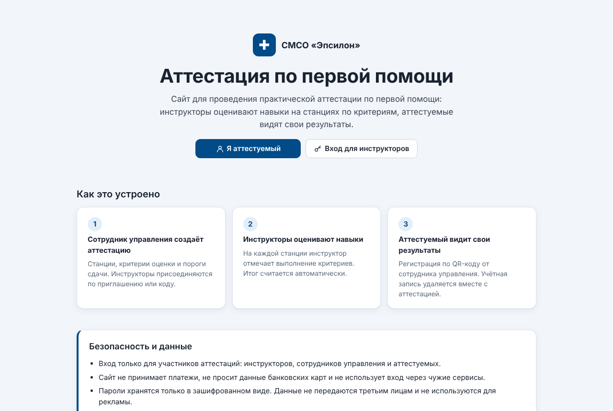
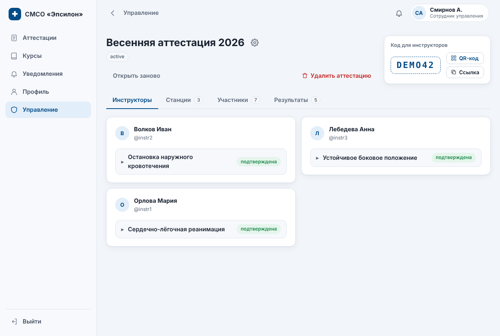
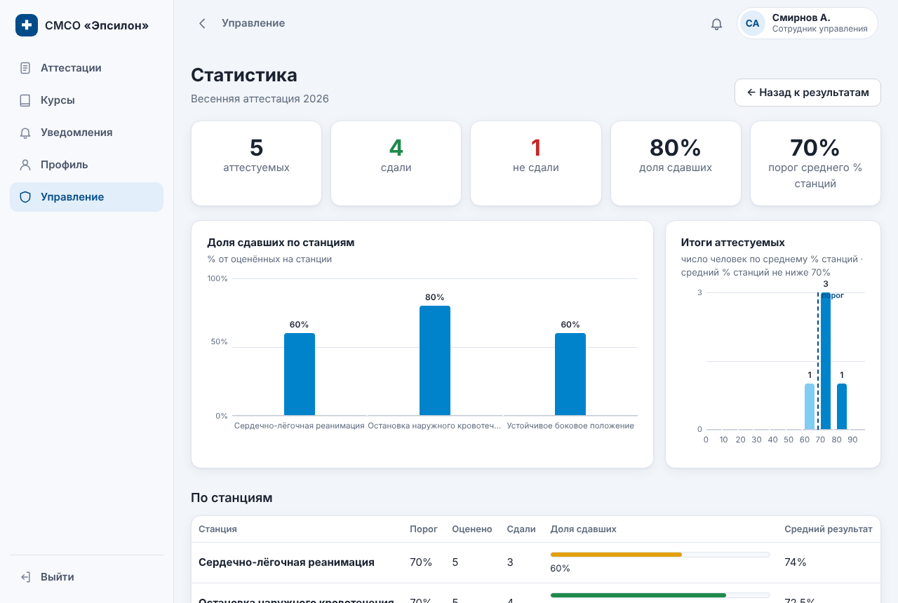
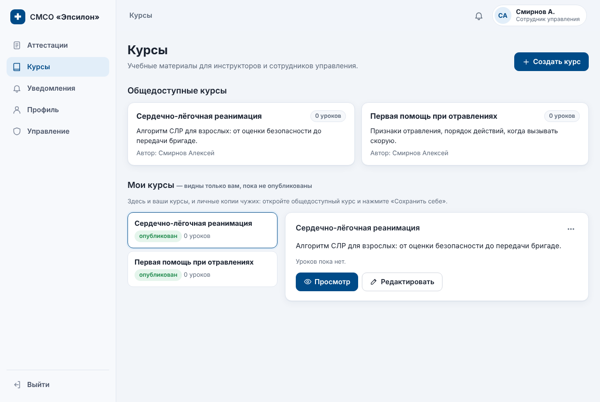

# СМСО — практическая аттестация по первой помощи

Веб-приложение для студенческого спасательного отряда. Через него проводят практическую аттестацию по первой помощи: сотрудник управления собирает аттестацию из станций и критериев, инструкторы оценивают навыки прямо с телефона, итоги считаются автоматически и выгружаются в Excel. Также в приложении есть учебные курсы и простой электронный документооборот.

**Демо:** https://smso.infy.click (рабочий сайт отряда; на скриншотах вымышленные данные)

| Карточка аттестации | Статистика |
|---|---|
|  |  |

| Курсы | Мобильная версия |
|---|---|
|  |  |

## Что умеет

- **Мастер аттестации**: станции, критерии с допустимыми оценками (например 0 / 0,5 / 1), пороги сдачи для станции и для аттестации, режим подсчёта итога.
- **Инструкторы** присоединяются по коду или QR-коду, берут станции и оценивают аттестуемых. Сотрудник управления подтверждает станции и судей.
- **Аттестуемые** регистрируются по QR-коду и видят свои результаты. Их учётные записи удаляются вместе с аттестацией.
- **Статистика**: доля сдавших по станциям, распределение итогов, средние баллы.
- **Выгрузка в Excel с живыми формулами**. Генератор `.xlsx` написан с нуля на `ZipArchive`: если поменять порог в ячейке-параметре, итог пересчитается.
- **Документы**: шаблоны Word с полями `{ФИО}`, `{Дата}`. Пользователь заполняет форму, а система подставляет значения в `.docx` и сохраняет оформление, даже когда Word разрезал поле на несколько фрагментов.
- **Курсы и уроки** с разделами и отметкой прогресса.
- **Роли**: аттестуемый, инструктор, сотрудник управления, системный администратор, плюс коды для выдачи ролей.
- **PWA и push-уведомления**: Web Push (RFC 8291, VAPID) реализован без сторонних библиотек, есть офлайн-страница.
- **Автомиграции схемы БД**: после выкладки новой версии недостающие таблицы и столбцы создаются сами.

## Технологии

PHP 8 без фреймворков · MySQL · PDO с подготовленными запросами · ванильный JavaScript · CSS · PWA (Service Worker, Web Push) · генерация XLSX/DOCX без сторонних библиотек.

## Установка

1. Создайте базу MySQL (подойдёт любой хостинг с PHP 8 и MySQL, проект работает и на бесплатном InfinityFree).
2. Скопируйте `config.local.sample.php` в `config.local.php` и впишите доступы к базе. Этот файл не попадает в git.
3. Загрузите файлы на хостинг и откройте `install.php`. Он создаст таблицы и покажет их структуру.
4. Пример учебного курса для импорта лежит в `sql/course_poisoning_first_aid.sql`.

## Структура

| Файл | Назначение |
|---|---|
| `config.php` | подключение к БД, обработка ошибок, сессия |
| `schema.php` | описание таблиц и автоматическая миграция |
| `functions.php` | общие функции: роли, вывод страниц, уведомления |
| `attestation*.php`, `station*.php`, `score_wizard.php` | аттестации, станции, оценивание |
| `xlsx.php`, `attestation_xlsx.php` | генератор Excel и выгрузка результатов |
| `docx.php`, `docs.php` | шаблоны Word и заявки на документы |
| `course*.php`, `lesson*.php` | курсы и уроки |
| `webpush.php`, `push_api.php`, `sw.js` | push-уведомления и Service Worker |
